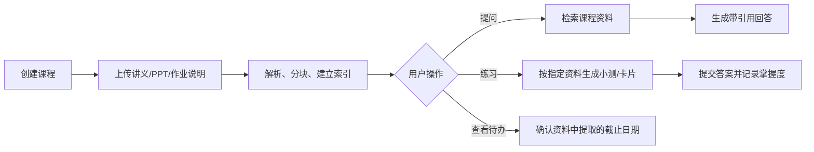
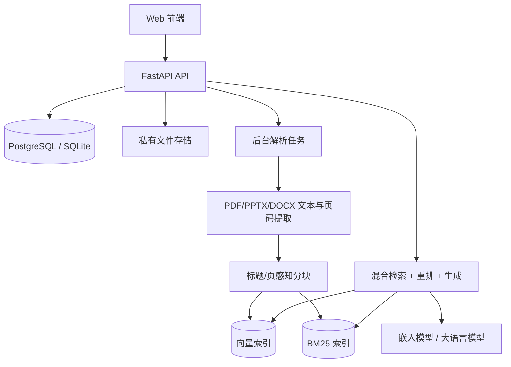

# 14 · 课程资料学习助手 · 项目文档

## 1. 项目定义

**课程资料学习助手（CourseMate）** 是一个面向学生的私有学习工作台。学生上传一门课的 PPT、讲义、作业说明和个人笔记后，可以围绕这些资料提问、获得带页码出处的回答、生成小测和复习卡，并沉淀错题与待办。

一句话：**让散落的课程资料变成可追溯、可练习、可复习的个人知识库。**

它不是通用聊天机器人，也不替学生完成作业；它的回答必须优先基于用户已上传的课程材料，并明确展示依据。

## 2. 问题与目标用户

### 2.1 要解决的问题

学生常把资料分散在课程群、网盘、下载目录和笔记软件中。复习时通常需要反复翻页、搜索关键词，再判断一段内容是否来自老师指定材料。作业截止日期和格式要求也容易遗漏。

CourseMate 将“找资料、核对出处、整理重点、练习复习”收敛到一个界面：

- 找答案：用自然语言查已上传材料；
- 看依据：回答附文件名、页码和原文片段；
- 做练习：从指定资料生成可回溯的小测与记忆卡；
- 管待办：从作业说明中提取截止时间，供用户确认后加入提醒。

### 2.2 初始用户

第一版只服务**单个学生的个人账户**，优先验证“自己和同学是否愿意每天用”。

典型场景：

| 场景 | 用户提问或操作 | 成功结果 |
|---|---|---|
| 课后回顾 | “第 4 讲怎么解释死锁？” | 有简洁解释，能点回对应 PPT 页 |
| 作业核对 | “本次实验报告要交什么、何时截止？” | 列出要求与日期，并附原文 |
| 考前复习 | “根据第 1–6 讲出 10 道选择题” | 题目、答案、解析都对应材料 |
| 错题复盘 | “只复习我做错过的网络层知识点” | 返回错题关联的卡片与来源 |
| 信息不足 | “老师会不会点名？” | 明确说明资料中没有依据，不臆测 |

## 3. MVP 范围

### 3.1 必做功能

1. **账户与课程**：注册/登录；创建课程；课程之间的数据完全隔离。
2. **资料上传与解析**：支持 PDF、PPTX、DOCX、Markdown、TXT；显示解析状态与失败原因。
3. **资料库问答**：限定在一门课程内提问，返回答案、置信状态、引用和原文定位。
4. **引用查看**：引用至少展示文件名、页码/幻灯片页、章节和原文片段；可打开原文件。
5. **小测**：按选定资料生成选择题或简答题；用户提交后记录对错与解析出处。
6. **复习卡**：由用户选定章节生成问答卡；支持“掌握/不熟”标记。
7. **资料待办**：从作业通知提取候选截止日期，必须由用户确认后才保存为待办。

### 3.2 第一版明确不做

| 不做 | 原因 |
|---|---|
| 自动代写作业、论文或代码 | 容易偏离学习辅助的价值，也难以保证诚信边界 |
| 多人共享资料库与复杂协作 | 先验证个人场景，减少权限和冲突复杂度 |
| 直接把模型回答当作事实 | 以引用和“无依据则拒答”为基本约束 |
| 日历/微信等第三方自动写入 | 初版只保存站内待办，避免授权和误操作 |
| 全量 OCR 与手写笔记识别 | 先支持可提取文本的文件；扫描件 OCR 作为后续增强 |

## 4. 用户流程



### 4.1 问答交互约束

- 默认只检索当前课程；跨课程检索必须由用户显式选择。
- 每个关键结论至少有一个有效引用；没有足够依据时返回拒答，而不是补全常识。
- 引用是答案的一部分：用户可看到原文、页码和文件名。
- “总结/出题”必须展示其使用的资料范围与生成时间。

## 5. 系统架构



### 5.1 推荐技术栈

| 层 | 推荐方案 | 选择理由 |
|---|---|---|
| 后端 | Python 3.12 + FastAPI | 异步 API、类型校验和自动接口文档成熟 |
| 前端 | React + Vite（或 Next.js） | 适合文件管理、聊天与学习记录界面 |
| 关系数据 | 开发期 SQLite，部署期 PostgreSQL | 快速起步，同时保留迁移空间 |
| 文件存储 | 本地目录起步，后续 MinIO/S3 | 文件与元数据分离，便于迁移 |
| 文本提取 | PyMuPDF、python-pptx、python-docx | 能保留页码/幻灯片定位信息 |
| 检索 | 向量检索 + BM25 + RRF + 可选重排 | 兼顾语义、术语和课件关键词 |
| 后台任务 | FastAPI BackgroundTasks 起步；Celery/Redis 后续引入 | 上传解析不阻塞用户请求 |
| 模型 | 可配置的 embedding / rerank / LLM Provider | 避免与单一供应商绑定 |

## 6. 数据模型（第一版）

| 实体 | 核心字段 | 说明 |
|---|---|---|
| User | id、email、password_hash、created_at | 用户身份 |
| Course | id、user_id、name、semester、color | 一门课程 |
| SourceFile | id、course_id、name、mime_type、storage_key、status | 原始上传文件与解析状态 |
| DocumentPage | id、file_id、page_no、text | PDF 页或 PPT 幻灯片的可定位文本 |
| Chunk | id、course_id、file_id、page_from、page_to、heading、text、embedding_ref | RAG 检索单元 |
| Conversation / Message | id、course_id、role、content、citations | 问答历史；不作为事实依据 |
| Quiz / QuizQuestion / Attempt | 来源范围、题目、答案、作答结果 | 小测与错题记录 |
| Flashcard / Review | question、answer、source_chunk_ids、mastery | 卡片与掌握状态 |
| Task | title、due_at、source_file_id、confirmed | 用户确认后的课程待办 |

**关键约束**：所有检索数据必须带 `user_id` 与 `course_id` 过滤条件；任何接口不得仅凭 chunk ID 返回别的用户资料。

## 7. RAG 设计

### 7.1 摄入

1. 校验文件大小、MIME 类型和归属课程；
2. 提取带页码/幻灯片编号的文本；
3. 以标题、页面和语义边界分块，避免跨页引用无法定位；
4. 写入 `Chunk` 元数据，生成向量，并建立 BM25 索引；
5. 更新文件状态：`queued → processing → ready / failed`。

### 7.2 查询

1. 用 `user_id + course_id` 强制过滤候选资料；
2. 稠密检索与 BM25 各取 Top-K；
3. 用 RRF 融合，可选 cross-encoder 重排；
4. 低置信度或检索为空时直接拒答；
5. 将 Top-N 原文和定位信息送入模型；
6. 要求模型返回结构化 JSON：`answer`、`citation_indices`、`confidence`；
7. 校验引用编号与候选文段一致后再对外返回。

### 7.3 提示词原则

- 仅根据提供的“课程资料”回答；
- 不足以回答时输出固定拒答结论；
- 区分“资料中的事实”与“基于资料的学习建议”；
- 不输出未引用的关键结论；
- 题目与解析必须能映射到来源 chunk。

## 8. API 草案

| 方法 | 路径 | 用途 |
|---|---|---|
| `POST` | `/api/v1/auth/register` | 注册 |
| `POST` | `/api/v1/auth/login` | 登录并取得 token |
| `GET/POST` | `/api/v1/courses` | 列出/创建课程 |
| `POST` | `/api/v1/courses/{id}/files` | 上传课程资料 |
| `GET` | `/api/v1/files/{id}` | 查询解析状态与元数据 |
| `POST` | `/api/v1/courses/{id}/query` | 课程资料问答 |
| `POST` | `/api/v1/courses/{id}/quizzes` | 按资料范围生成小测 |
| `POST` | `/api/v1/quizzes/{id}/attempts` | 提交作答 |
| `GET/POST` | `/api/v1/courses/{id}/flashcards` | 查看/创建复习卡 |
| `GET/PATCH` | `/api/v1/courses/{id}/tasks` | 查看/确认/修改待办 |

`POST /api/v1/courses/{id}/query` 请求示例：

```json
{ "question": "本次实验报告有哪些必填部分？" }
```

响应必须包含：

```json
{
  "answer": "实验报告应包含……",
  "abstained": false,
  "citations": [
    {
      "file_name": "实验一要求.pdf",
      "page": 2,
      "snippet": "报告应包含实验目的、环境……"
    }
  ]
}
```

## 9. 验收与评测

不要只测“模型回答看起来不错”。选一门自己正在学习的课程，建立 40–60 条小型评测集：问题、标准出处、是否应拒答。至少 15% 为无答案问题。

| 维度 | 指标 | MVP 验收目标 |
|---|---|---|
| 检索 | Recall@5 | ≥ 0.80 |
| 引用 | 页码/文件定位合法率 | 100% |
| 引用 | 抽样支持率 | ≥ 90% |
| 拒答 | 无答案问题正确拒答率 | ≥ 80% |
| 体验 | 已索引课程的问答 p95 | ≤ 8 秒 |
| 可靠性 | 上传后解析成功率 | ≥ 95%（支持类型内） |

再邀请 3–5 位同学进行任务测试：上传一份课程资料、找到一项作业要求、完成一次小测。记录完成率、卡点和“是否愿意下次继续用”。这比单纯模型分数更能证明产品价值。

## 10. 开发里程碑（6 周）

| 周期 | 目标 | 可演示成果 |
|---|---|---|
| 第 1 周 | 项目骨架、用户/课程、文件上传 | 能创建课程并上传/查看文件 |
| 第 2 周 | PDF/PPTX 解析、分块、索引 | 文件显示解析状态，可搜索原文 |
| 第 3 周 | 带引用的课程问答与拒答 | 可回答并定位到页码 |
| 第 4 周 | 小测、作答与错题记录 | 从指定资料生成并完成练习 |
| 第 5 周 | 复习卡、待办、前端打磨 | 可形成个人复习闭环 |
| 第 6 周 | 评测、同学试用、部署与文档 | 指标报告、演示视频、可部署版本 |

## 11. 风险与边界

| 风险 | 应对 |
|---|---|
| 模型将常识当作资料结论 | 强制引用；无引用不展示为事实；低分拒答 |
| 不同用户的数据串库 | 所有查询加入 `user_id/course_id` 强制过滤；做越权测试 |
| 扫描 PDF 无法提取文本 | 明示“待 OCR”；后续异步 OCR，不伪造解析成功 |
| PPT 排版复杂、文本顺序混乱 | 以幻灯片为最小定位单位；保留原文件预览 |
| 生成题目错误 | 题目必须显示来源；用户可标记“题目有误” |
| 文件与学习记录隐私 | 私有存储、下载鉴权、删除课程时同时删除索引与文件 |

## 12. 项目成功的定义

项目成功不是“接入了大模型”，而是满足以下三点：

1. 学生能在 3 分钟内完成上传资料、提问、打开引用原文；
2. 回答无依据时系统能可靠地说不知道，而不是编造；
3. 至少 3 位同学能用它完成一次真实学习任务，并愿意在下一门课继续使用。

