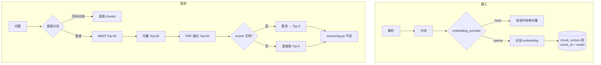

# CourseMate · RAG 升级改造清单

> 目标版本：MVP v1.1
> 编写依据：`backend/app/services/retrieval.py`、`answering.py`、`ingest.py`、`config.py`、`models.py`（2026-10-20 代码快照）
> 实施状态：**阶段 0–4 已完成并合入，阶段 5 待接入真实 embedding 后收尾**（见文末「实施记录」）

## 0. 一句话目标

把检索端从**词面近似**升级为**真语义向量 + 重排**，同时**不破坏**当前"无 API Key 也能完整演示"的离线能力。

## 1. 约束（先看这一节，违反任何一条都算方案失败）

| 约束 | 具体要求 |
|---|---|
| C1 不破坏离线 | `COURSEMATE_EMBEDDING_PROVIDER=hash`（默认值）时，行为与现在**逐字节一致**，35 个接口和 21 个测试文件全部照常通过 |
| C2 不破坏引用 | `answering.py` 的引用校验、`MIN_COVERAGE` 拒答门槛、降级逻辑**一行都不改** |
| C3 不改前端契约 | `QueryResponse` 字段不变；新增能力只能加可选字段 |
| C4 失败不阻断 | 向量化/重排任何异常都降级到 hash / 不重排，绝不把文件标成 `failed` |
| C5 可回滚 | 改一个环境变量即可退回当前状态，不需要回滚数据库 |

## 2. 现状基线：要动的四处

| 位置 | 现状 | 问题 |
|---|---|---|
| `retrieval.py:43-45` `_vector_dim()` | `blake2b(term) % 768`，哈希技巧 | 没有语义，同义词/跨语言召回为 0 |
| `retrieval.py:72-81` 建向量 | 词频 × IDF 投到哈希桶，L2 归一化 | 同上 |
| `retrieval.py:158-191` `_CACHE` | `dict[course_id, (index_version, CourseIndex)]` | 缓存键不含向量模型，换模型后读到脏索引 |
| `query.py:125` 检索 | `hybrid_search(..., top_k=6)` 直接进生成 | 无重排，Top-6 里噪声直接进 prompt |

**保留不动**：`analysis.py` 的 bigram 分词（BM25 分支继续用）、`chunking.py` 分块、`answering.py` 全部。

## 3. 总体设计



关键决策（写在这里是为了避免后续反复讨论）：

1. **向量单独存表**，不动 `chunks` 表。主键 `(chunk_id, model)`，换模型不销毁旧向量，可灰度对比。
2. **embedding 用 OpenAI 兼容 `/embeddings` 接口**，不绑死供应商；与现有 `llm_*` 配置风格一致。
3. **rerank 用 Cohere/Jina 兼容 `/rerank` 接口**，默认关闭。
4. **hash 路径保留为正式 provider**，不是临时补丁——它是"零依赖演示"的保障。

## 4. 改动面一览

| 文件 | 类型 | 说明 |
|---|---|---|
| `backend/app/config.py` | 修改 | +9 个配置字段 |
| `backend/app/services/embedding.py` | **新增** | Embedder 协议、OpenAI 实现、工厂 |
| `backend/app/services/rerank.py` | **新增** | 重排调用与降级 |
| `backend/app/models.py` | 修改 | +`ChunkVector` 表 |
| `backend/app/services/retrieval.py` | 修改 | 支持外部向量、缓存键加模型 |
| `backend/app/services/ingest.py` | 修改 | 解析后自动向量化（容错） |
| `backend/app/routers/query.py` | 修改 | 接线 query 向量 + 重排 |
| `backend/app/routers/health.py` | 修改 | 暴露向量覆盖率 |
| `backend/scripts/reindex_vectors.py` | **新增** | 历史数据回填 |
| `backend/eval/run_eval.py` | 修改 | 支持 `--save` / `--baseline` 对比 |
| `backend/eval/semantic.json` | **新增** | 10 条语义改写评测集 |
| `backend/tests/test_embedding.py` | **新增** | 向量层单测（mock HTTP） |
| `backend/tests/test_retrieval.py` | 修改 | +外部向量用例 |
| `.env.example` / `README.md` / `docs/架构设计.md` | 修改 | 配置与文档同步 |

---

## 5. 任务清单

按顺序执行，每个阶段结束都应该能跑通测试并提交。

### 阶段 0 · 基线固化（必须先做，否则无法证明升级有效）

- [x] **R0.1 存档当前评测结果**

```powershell
cd backend
..\.venv\Scripts\python.exe eval\run_eval.py | Tee-Object -FilePath eval\baseline_v1.json
```

验收：`backend/eval/baseline_v1.json` 存在，`Recall@5 = 1.000`、拒答 `8/8`。

- [x] **R0.2 新增语义评测集 `backend/eval/semantic.json`（这一步最重要）**

现有 40 条数据集全部命中，**升级后指标不可能上涨**，无法证明改造有价值。必须新增一组"词面不重合、语义相同"的问题，例如：

| 问题（中文） | 预期命中（英文原文） |
|---|---|
| 为什么需要给网络分层？ | `layered architecture reduces complexity` |
| 交换机是怎么转发数据的？ | `forward frames based on MAC table` |
| 网络拥塞了会怎样？ | `congestion leads to packet loss` |
| 怎么保证数据不传错？ | `error detection and correction` |
| 地址不够用了怎么办？ | `NAT alleviates IPv4 exhaustion` |

格式与 `dataset.json` 保持一致（`id / question / file / locator / answerable`），先跑一遍记录**改造前分数**（预期很低，0.1–0.3）。

验收：`semantic.json` 至少 10 条，其中 8 条可答、2 条无答案；改造前 Recall@5 记录在案。

> 这组数据的分数提升，才是这个升级唯一的硬证据。原 40 条只用来做"不回退"检查。

---

### 阶段 1 · 配置与向量抽象

- [x] **R1.1 `config.py` 增加字段**

在 `Settings` 的 `llm_model` 之后插入：

```python
    embedding_provider: str = "hash"          # hash | openai
    embedding_base_url: str = ""
    embedding_api_key: str = ""
    embedding_model: str = ""
    embedding_dim: int = 1024
    embedding_batch: int = 32
    rerank_enabled: bool = False
    rerank_base_url: str = ""
    rerank_api_key: str = ""
    rerank_model: str = ""
```

在 `load_settings()` 的 `return Settings(...)` 中补：

```python
        embedding_provider=os.environ.get("COURSEMATE_EMBEDDING_PROVIDER", "hash").strip().lower(),
        embedding_base_url=os.environ.get("COURSEMATE_EMBEDDING_BASE_URL", "").strip(),
        embedding_api_key=os.environ.get("COURSEMATE_EMBEDDING_API_KEY", "").strip(),
        embedding_model=os.environ.get("COURSEMATE_EMBEDDING_MODEL", "").strip(),
        embedding_dim=int(os.environ.get("COURSEMATE_EMBEDDING_DIM", "1024") or 1024),
        embedding_batch=int(os.environ.get("COURSEMATE_EMBEDDING_BATCH", "32") or 32),
        rerank_enabled=os.environ.get("COURSEMATE_RERANK_ENABLED", "0") == "1",
        rerank_base_url=os.environ.get("COURSEMATE_RERANK_BASE_URL", "").strip(),
        rerank_api_key=os.environ.get("COURSEMATE_RERANK_API_KEY", "").strip(),
        rerank_model=os.environ.get("COURSEMATE_RERANK_MODEL", "").strip(),
```

同步 `.env.example`：

```bash
# 向量化 provider：hash（默认，零依赖）| openai（OpenAI 兼容 /embeddings）
COURSEMATE_EMBEDDING_PROVIDER=hash
# COURSEMATE_EMBEDDING_BASE_URL=https://api.siliconflow.cn/v1
# COURSEMATE_EMBEDDING_API_KEY=
# COURSEMATE_EMBEDDING_MODEL=BAAI/bge-m3
# COURSEMATE_EMBEDDING_DIM=1024

# 重排（默认关闭）
COURSEMATE_RERANK_ENABLED=0
# COURSEMATE_RERANK_BASE_URL=https://api.jina.ai/v1
# COURSEMATE_RERANK_API_KEY=
# COURSEMATE_RERANK_MODEL=jina-reranker-v2-base-multilingual
```

验收：`pytest tests/test_config.py` 通过；新增一个断言覆盖 `COURSEMATE_EMBEDDING_PROVIDER=hash` 默认值。

- [x] **R1.2 新建 `backend/app/services/embedding.py`**

```python
"""向量化抽象：hash（零依赖，现状）| openai（OpenAI 兼容 /embeddings）。"""

from __future__ import annotations

import json
import logging
import math
from typing import Any, Protocol
from urllib.error import HTTPError, URLError
from urllib.request import Request, urlopen

logger = logging.getLogger(__name__)


class EmbeddingError(RuntimeError):
    """向量化失败；调用方应降级到 hash 而不是中断解析。"""


class Embedder(Protocol):
    name: str
    dim: int

    def embed(self, texts: list[str]) -> list[list[float]]: ...


def _endpoint(base_url: str, path: str) -> str:
    base_url = base_url.rstrip("/")
    return base_url if base_url.endswith(path) else f"{base_url}{path}"


def _l2_normalise(vector: list[float]) -> list[float]:
    norm = math.sqrt(sum(value * value for value in vector)) or 1.0
    return [value / norm for value in vector]


class OpenAIEmbedder:
    """OpenAI 兼容 /embeddings；输出统一 L2 归一化，便于直接点积。"""

    def __init__(
        self,
        *,
        base_url: str,
        api_key: str,
        model: str,
        dim: int,
        batch: int = 32,
        timeout: float = 15.0,
    ) -> None:
        self.name = model
        self.dim = dim
        self._url = _endpoint(base_url, "/embeddings")
        self._api_key = api_key
        self._model = model
        self._batch = max(1, batch)
        self._timeout = timeout

    def embed(self, texts: list[str]) -> list[list[float]]:
        if not texts:
            return []
        vectors: list[list[float]] = []
        for start in range(0, len(texts), self._batch):
            vectors.extend(self._embed_batch(texts[start : start + self._batch]))
        return vectors

    def _embed_batch(self, texts: list[str]) -> list[list[float]]:
        body = {"model": self._model, "input": texts}
        request = Request(
            self._url,
            data=json.dumps(body, ensure_ascii=False).encode("utf-8"),
            method="POST",
            headers={
                "Content-Type": "application/json",
                "Authorization": f"Bearer {self._api_key}",
            },
        )
        try:
            with urlopen(request, timeout=self._timeout) as response:  # noqa: S310
                payload = json.loads(response.read().decode("utf-8"))
        except (HTTPError, URLError, TimeoutError) as exc:
            raise EmbeddingError("向量服务暂不可用") from exc

        items = payload.get("data")
        if not isinstance(items, list) or len(items) != len(texts):
            raise EmbeddingError("向量服务返回格式异常")
        ordered = sorted(items, key=lambda item: item.get("index", 0))
        vectors = []
        for item in ordered:
            vector = item.get("embedding")
            if not isinstance(vector, list) or not vector:
                raise EmbeddingError("向量服务返回空向量")
            vectors.append(_l2_normalise([float(value) for value in vector]))
        if vectors and len(vectors[0]) != self.dim:
            raise EmbeddingError(
                f"向量维度不匹配：配置 {self.dim}，实际 {len(vectors[0])}"
            )
        return vectors


def get_embedder(settings: Any) -> Embedder | None:
    """返回可用 embedder；hash 或配置不全时返回 None，调用方走原哈希路径。"""
    if settings.embedding_provider != "openai":
        return None
    if not (settings.embedding_base_url and settings.embedding_api_key and settings.embedding_model):
        logger.warning("embedding_provider=openai 但配置不完整，已回退 hash 向量")
        return None
    return OpenAIEmbedder(
        base_url=settings.embedding_base_url,
        api_key=settings.embedding_api_key,
        model=settings.embedding_model,
        dim=settings.embedding_dim,
        batch=settings.embedding_batch,
    )


def embedder_name(settings: Any) -> str:
    """缓存键用的向量身份；hash 模式固定返回 'hash-768'。"""
    embedder = get_embedder(settings)
    return embedder.name if embedder else "hash-768"


def embed_texts(settings: Any, texts: list[str]) -> list[list[float]] | None:
    """容错版：任何失败都返回 None，由调用方降级。"""
    embedder = get_embedder(settings)
    if embedder is None:
        return None
    try:
        return embedder.embed(texts)
    except EmbeddingError:
        logger.warning("向量化失败，已降级为哈希向量", exc_info=True)
        return None
```

验收：`from app.services.embedding import get_embedder` 在 `hash` 配置下返回 `None`，不发起任何网络请求。

- [x] **R1.3 新建 `backend/tests/test_embedding.py`**

必测四条：① `hash` 模式返回 `None`；② 配置不全返回 `None`；③ mock `urlopen` 返回乱序 `data` 时按 `index` 正确排序；④ 维度不符抛 `EmbeddingError`。

验收：`pytest tests/test_embedding.py -q` 全绿，且不产生真实网络调用。

---

### 阶段 2 · 向量存储与回填

- [x] **R2.1 `models.py` 增加 `ChunkVector`**

```python
class ChunkVector(Base):
    """chunk 的向量缓存；按模型区分，换模型不销毁旧向量。"""

    __tablename__ = "chunk_vectors"

    chunk_id: Mapped[str] = mapped_column(
        String(32), ForeignKey("chunks.id", ondelete="CASCADE"), primary_key=True
    )
    model: Mapped[str] = mapped_column(String(120), primary_key=True)
    dim: Mapped[int] = mapped_column(Integer)
    vector: Mapped[bytes] = mapped_column(LargeBinary)
    updated_at: Mapped[datetime] = mapped_column(
        DateTime(timezone=True), default=utcnow, onupdate=utcnow
    )
```

`models.py` 顶部 import 补 `LargeBinary`。

**注意**：`main.py:91` 已经 `Base.metadata.create_all(engine)`，新表会自动建，`migrate_schema` **不需要**加 ALTER。旧库升级时表会被自动创建。

- [x] **R2.2 新建 `backend/scripts/reindex_vectors.py`**

要求：
- 支持 `--course-id <id>` 只处理单课程，`--force` 覆盖已有向量，`--dry-run` 只统计；
- 按 `chunk.file_id, chunk.ord` 顺序取，`heading + "\n" + text` 作为向量输入（与 `retrieval.py:59` 的 BM25 输入保持一致）；
- 每批 `settings.embedding_batch` 条，批量 upsert（先 `delete` 同 `chunk_id + model` 再 `insert`）；
- 打印进度：`course=xxx chunks=120 embedded=120 skipped=0`。

验收：
```powershell
cd backend
..\.venv\Scripts\python.exe scripts\reindex_vectors.py --dry-run
```
输出统计与实际 `chunks` 行数一致；无 API Key 时给出明确提示并 `exit 2`。

- [x] **R2.3 覆盖率查询**

`health.py` 的 `/health` 增加：

```json
{"vector_coverage": {"model": "BAAI/bge-m3", "chunks": 120, "embedded": 120}}
```

SQL：`SELECT COUNT(*) FROM chunks c LEFT JOIN chunk_vectors v ON v.chunk_id=c.id AND v.model=:model WHERE v.chunk_id IS NULL`。

验收：覆盖率不是 100% 时，前端或日志能看出来——这是排查"为什么检索没变好"的第一现场。

---

### 阶段 3 · 检索层改造（核心）

- [x] **R3.1 `retrieval.py`：`CourseIndex` 支持外部向量**

改 `__init__` 签名，**默认参数保证现有测试不受影响**：

```python
    def __init__(
        self,
        chunks: list[ChunkView],
        embeddings: list[list[float]] | None = None,
    ) -> None:
        ...
        self.hash_vectors: list[dict[int, float]] = []
        self.dense_vectors: list[list[float]] | None = None
        ...
        if embeddings is not None and len(embeddings) == len(chunks):
            self.dense_vectors = embeddings
        else:
            if embeddings is not None:
                logger.warning("向量数量与 chunk 不一致，回退哈希向量")
            self._build_hash_vectors()
```

把原来 72-81 行建向量的循环抽成 `_build_hash_vectors()`，只写 `self.hash_vectors`。

- [x] **R3.2 `search()` 增加 `query_vector` 参数**

```python
    def search(
        self,
        query: str,
        top_k: int = 8,
        query_vector: list[float] | None = None,
    ) -> list[SearchHit]:
        query_tokens = tokenize(query)
        if not query_tokens or not self.chunks:
            return []
        query_tf = Counter(query_tokens)
        bm25_scores = self._bm25_scores(query_tf)

        if self.dense_vectors is not None and query_vector is not None:
            dense_scores = [
                sum(a * b for a, b in zip(vector, query_vector))
                for vector in self.dense_vectors
            ]
        else:
            dense_scores = self._hash_dense_scores(query_tf)
        # 以下 RRF 融合逻辑保持不变
```

**不要改** RRF 那段（125-155 行），它是当前唯一稳定的排序保证。

- [x] **R3.3 缓存键加入向量模型**

```python
_CACHE: dict[str, tuple[int, str, CourseIndex]] = {}

def get_course_index(db: Session, course: Course, settings) -> CourseIndex:
    name = embedder_name(settings)
    with _LOCK:
        cached = _CACHE.get(course.id)
    if cached is not None and cached[0] == course.index_version and cached[1] == name:
        return cached[2]
    views = load_chunk_views(db, course.id)
    index = CourseIndex(views, _load_vectors(db, views, name, settings))
    with _LOCK:
        _CACHE[course.id] = (course.index_version, name, index)
    return index
```

`_load_vectors()` 逻辑：`name == "hash-768"` 直接返回 `None`；否则查 `chunk_vectors`，**按 `views` 顺序**组装，缺失的 chunk 用 `None` 占位——只要有任一缺失，整体返回 `None` 走 hash 兜底，避免"一半语义一半哈希"的混合排序。

- [x] **R3.4 `hybrid_search` 透传 query 向量**

```python
def hybrid_search(
    db: Session, course: Course, settings, query: str, top_k: int = 8
) -> list[SearchHit]:
    query_vector = None
    vectors = embed_texts(settings, [query])
    if vectors:
        query_vector = vectors[0]
    return get_course_index(db, course, settings).search(
        query, top_k=top_k, query_vector=query_vector
    )
```

**注意调用方签名变化**：`query.py:125`、`query.py:129`、`tests/test_query.py` 里所有 `hybrid_search(...)` 调用都要补 `settings`。用 IDE 全局搜索一次改干净。

- [x] **R3.5 `ingest.py`：解析后自动向量化（容错）**

在 `process_file` 的 `db.add(Chunk(...))` 循环后、`status = "ready"` 之前插入：

```python
        db.flush()  # 拿到 chunk.id
        new_chunk_ids = [row.id for row in db.scalars(
            select(Chunk).where(Chunk.file_id == file_id).order_by(Chunk.ord)
        ).all()]
        _embed_chunks(db, settings, new_chunk_ids)
```

`_embed_chunks` 实现要点：

```python
def _embed_chunks(db: Session, settings, chunk_ids: list[str]) -> None:
    if not chunk_ids or get_embedder(settings) is None:
        return
    chunks = [db.get(Chunk, cid) for cid in chunk_ids]
    texts = [f"{c.heading}\n{c.text}" for c in chunks if c is not None]
    vectors = embed_texts(settings, texts)
    if vectors is None:
        return  # 静默降级：文件仍为 ready，只是没有语义向量
    model = settings.embedding_model
    db.execute(delete(ChunkVector).where(
        ChunkVector.chunk_id.in_(chunk_ids), ChunkVector.model == model
    ))
    for chunk, vector in zip(chunks, vectors):
        db.add(ChunkVector(
            chunk_id=chunk.id, model=model, dim=len(vector),
            vector=array.array("f", vector).tobytes(),
        ))
```

**关键**：这个函数**绝不能抛异常**，外面再包一层 `try/except Exception` 记 warning。C4 约束靠这里落实。

- [x] **R3.6 `query.py` 接线**

三处 `hybrid_search` 调用补 `settings` 参数（`settings` 已在 115 行取到）。

验收（阶段 3 完成时）：
```powershell
powershell -ExecutionPolicy Bypass -File scripts\test.ps1
```
21 个测试文件全绿；`COURSEMATE_EMBEDDING_PROVIDER=hash` 下 `run_eval.py` 结果与 `baseline_v1.json` **完全一致**。

---

### 阶段 4 · 重排

- [x] **R4.1 新建 `backend/app/services/rerank.py`**

Cohere/Jina 兼容 `/rerank` 协议：

```python
def rerank_available(settings: Any) -> bool:
    return bool(settings.rerank_enabled and settings.rerank_base_url
                and settings.rerank_api_key and settings.rerank_model)


def rerank_hits(settings, question, hits, top_k):
    """失败或未启用时原样返回，调用方无需判断。"""
    if not rerank_available(settings) or len(hits) <= 1:
        return hits
    try:
        scores = _call_rerank(settings, question, [hit.chunk.text for hit in hits])
    except Exception:  # noqa: BLE001 - 重排是增强，不能影响主流程
        logger.warning("重排失败，沿用 RRF 排序", exc_info=True)
        return hits[:top_k]
    order = sorted(range(len(hits)), key=lambda i: scores.get(i, 0.0), reverse=True)
    return [hits[i] for i in order[:top_k]]
```

`_call_rerank` 请求体：`{"model": ..., "query": ..., "documents": [...], "top_n": len(hits)}`，返回 `results[].index / relevance_score`。

- [x] **R4.2 `query.py` 插入重排**

```python
    else:
        hits = hybrid_search(db, course, settings, payload.question, top_k=50)
        hits = rerank_hits(settings, payload.question, hits, top_k=6)
        if not hits and model_enabled:
            ...
```

注意：**Top-K 从 6 改成 50 再重排到 6**，否则重排没有候选空间。`page_hits` / `summary_hits` 分支不重排。

- [x] **R4.3 开关默认关闭**

`rerank_enabled=False` 时 `rerank_hits` 直接返回 `hits[:top_k]`，行为与现状一致（只是多切了一刀，无副作用）。

验收：关闭时 `test_query.py` 全绿；打开但填错 Base URL 时，接口仍返回 200 且日志有 warning。

---

### 阶段 5 · 验收与收尾

- [x] **R5.1 `run_eval.py` 支持对比**

加两个参数：`--save <path>` 保存结果，`--baseline <path>` 与基线逐题对比，输出新增/回退清单。

```powershell
cd backend
..\.venv\Scripts\python.exe eval\run_eval.py --baseline eval\baseline_v1.json --save eval\after_v2.json
```

- [x] **R5.2 跑语义评测集**

```powershell
..\.venv\Scripts\python.exe eval\run_eval.py --dataset eval\semantic.json --save eval\baseline_v1_semantic.json
# 切到真实 embedding 后（待接入）
..\.venv\Scripts\python.exe eval\run_eval.py --dataset eval\semantic.json --save eval\semantic_openai.json
```

- [ ] **R5.3 硬门槛（全部满足才允许合并）** —— 代码链路已就绪，但「接入真实 embedding 前后对比」这一步需要真实 Key，尚未执行

| 指标 | 门槛 | 说明 |
|---|---|---|
| 语义集 Recall@5 | **≥ 0.80**，且比 hash 基线提升 ≥ 0.4 | 这是升级的唯一目的 |
| 原 40 条 Recall@5 | ≥ 1.000（不回退） | 现状已满分，只准持平 |
| 无答案拒答 | 8/8，不下降 | 语义召回变强后**最容易破的指标** |
| 引用定位合法率 | 100% | `answering.py` 未改，理论上必过 |
| p95 | ≤ 8000 ms | 含远程 embedding + rerank，注意首次冷启动 |
| 解析成功率 | 100%（7/7） | 向量化失败不能拖垮解析 |
| 无 Key 模式 | 21 个测试文件全绿 | C1 约束 |

> 重点盯"拒答率"：语义向量会让原本检索不到的无关问题也命中，`MIN_COVERAGE=0.2` 的门槛可能不够。如果拒答掉到 6/8，**不要调阈值糊弄过去**，优先检查是否该给 dense 通道加最低相似度下限（例如余弦 < 0.3 直接丢弃）。

- [x] **R5.4 文档同步**

- `README.md`：快速开始补 embedding 配置段；"当前进度"补一行；
- `docs/架构设计.md`：第 6 节检索实现改写（保留 hash 作为 fallback 说明）、第 11 节局限里删掉"哈希 TF-IDF"那条或降级描述；
- `docs/评测报告.md`：新增语义集对比小节，**如实写明**合成数据集的局限；
- `.env.example`：见 R1.1。

- [x] **R5.5 清理**

- `retrieval.py` 顶部 `VECTOR_DIM` 保留（hash 仍在用），但注释改成"仅 hash provider 使用"；
- 删除任何临时的 `print` / `TODO`；
- `git commit` 按阶段拆成 5 个 commit，便于单独 revert。

---

## 6. 风险与回滚

| 风险 | 触发条件 | 应对 |
|---|---|---|
| embedding 服务超时拖慢上传 | 大批量文件同时上传 | 后台线程内向量化，不阻塞响应；`timeout=15s` + 失败静默降级 |
| 换模型后向量维度不符 | 从 bge-m3(1024) 换到 text-embedding-3-small(1536) | 主键含 `model`，旧向量不冲突；`dim` 校验在 `OpenAIEmbedder` 里直接抛错并降级 |
| 语义召回变强导致拒答率下降 | 无关问题也被召回 | 先加余弦下限，再考虑调 `MIN_COVERAGE`；用语义集的 2 条无答案题做回归 |
| 进程内索引内存膨胀 | 万级 chunk × 1024 维 | float32 存 4KB/chunk，1 万块约 40MB，可接受；超过 5 万块再考虑换向量库 |
| 成本 | 每次上传都调 embedding | 按 chunk 计费，一门课通常 < 500 块；`--dry-run` 先估算 |

**回滚**：把 `.env` 改回 `COURSEMATE_EMBEDDING_PROVIDER=hash`、`COURSEMATE_RERANK_ENABLED=0`，重启即可。数据库里多出的 `chunk_vectors` 表不影响任何现有查询路径，可保留也可 `DROP TABLE`。

## 7. 建议顺序与工作量

| 阶段 | 内容 | 可独立提交 | 相对工作量 |
|---|---|---|---|
| 0 | 基线 + 语义评测集 | ✅ | 小 |
| 1 | 配置 + embedding 抽象 + 单测 | ✅ | 小 |
| 2 | 向量表 + 回填脚本 + 覆盖率 | ✅ | 中 |
| 3 | 检索改造（风险最高） | ✅ | 大 |
| 4 | 重排 | ✅ | 小 |
| 5 | 评测、文档、清理 | ✅ | 中 |

**先做 0，再做 3 的骨架（用假向量跑通链路），最后才接真实 API。** 这样即使 embedding 服务不可用，改造本身也能被测试覆盖。

---

## 7. 实施记录（2026-10-20）

阶段 0–4 已合入，阶段 5 的"接入真实 embedding 前后对比"待有 Key 后执行。

### 实际改动文件

| 文件 | 改动 |
|---|---|
| `backend/app/config.py` | +`embedding_provider` / `rerank_enabled` 等 9 个字段，`embedding_ready` / `rerank_ready` 两个布尔属性 |
| `backend/app/services/embedding.py` | **新增**`Embedder` 协议、`OpenAIEmbedder`（乱序重排、分批、维度校验）、`get_embedder` / `embed_texts` 容错版 |
| `backend/app/services/vectors.py` | **新增**float32 编解码、`vector_coverage`、`ensure_vectors`、`load_vectors`、`delete_vectors_for_model` |
| `backend/app/services/rerank.py` | **新增**Cohere / Jina 兼容 `/rerank`，失败降级为 RRF 顺序 |
| `backend/app/services/retrieval.py` | `CourseIndex` 支持外部向量；缓存键改为 `(index_version, 模型名)`；`hybrid_search` 透传 settings 与 query 向量 |
| `backend/app/services/ingest.py` | 解析成功后 `_embed_new_chunks` 自动补齐该文件向量，整体 try/except 兜底 |
| `backend/app/models.py` | +`ChunkVector`（主键 `chunk_id + model`） |
| `backend/app/routers/health.py` | `/health` 增加 `embedding` 块（provider / model / coverage / dense_ready） |
| `backend/app/routers/query.py` | 检索 Top-K 6 → 50，重排回 6 |
| `backend/scripts/reindex_vectors.py` | **新增**回填脚本，`--course-id` / `--force` / `--dry-run`，写完失效缓存，配置问题退出码 2 |
| `backend/eval/run_eval.py` | `--dataset` / `--save` / `--baseline` / `--no-report`；报告自动附带语义集章节 |
| `backend/eval/semantic.json` | **新增**12 条语义评测集 |

### 测试

新增 4 个测试文件、34 个用例，全量 **126 通过**。其中 `tests/test_rag_pipeline.py` 是端到端集成测试，
用本地桩服务同时充当 `/embeddings`、`/rerank`、`/chat/completions`，验证了完整链路：
英文提问 → 稠密检索命中中文块 → LLM 带引用回答。

### 三个必须先知道的结论

**1. 语义集基线是 0.000，不是 0.7。**
最初设计的 11 条中文同义改写题，在 18 个 chunk 的演示语料上 Top-5 几乎必然覆盖目标，
只有 3 条未命中，**没有判别力**。最终把关键权重放到 6 条英文提问上——哈希检索对
跨语言完全是 0。这也说明：语料太小时不要指望用同义改写题衡量检索质量。

**2. 语义检索只解决「找得到」，不解决「答得出」。**
集成测试里出现了这个现象：英文提问检索 100% 命中中文块，但 `_offline_answer`
仍然拒答——它按 query 词元在原文句子里找覆盖率，中文原文里没有 "deadlock"。
`tests/test_rag_pipeline.py::test_cross_lingual_recall_works_but_offline_still_refuses`
把这条行为固化了。**要让它真正可用，必须同时配 `COURSEMATE_LLM_PROVIDER=openai`。**

**3. 测试里踩到的两个 API 陷阱**，都在实现/测试里处理了：
- `files.py` 上传走 `BackgroundTasks`，测试里手动调 `run_ingest` 会和后台任务赛跑，
  需要 `_wait_until_ready` 轮询；
- `Settings` 是 frozen dataclass，测试里改配置必须用 `dataclasses.replace`。

### 未完成项

- **R5.3 硬门槛**：需要真实 embedding Key。拿到后只需跑第 9 节的两条命令即可出对比。
- **R5.4 的 `docs/评测报告.md`**：已把语义集章节并入报告生成逻辑，但真实分数的对比数字仍缺。

### 回滚

`.env` 里改回 `COURSEMATE_EMBEDDING_PROVIDER=hash`、`COURSEMATE_RERANK_ENABLED=0` 即可，
`chunk_vectors` 表不影响任何现有查询路径。已验证默认模式下 40 条评测逐题结果
与基线完全一致（改善 0、回退 0）。
