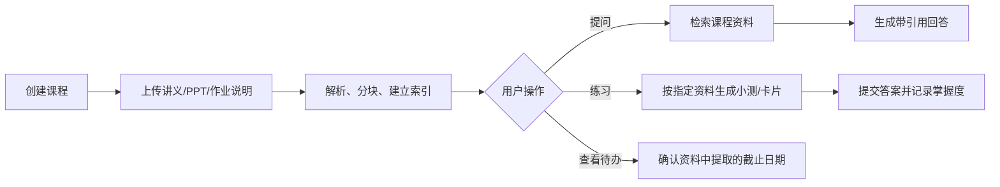
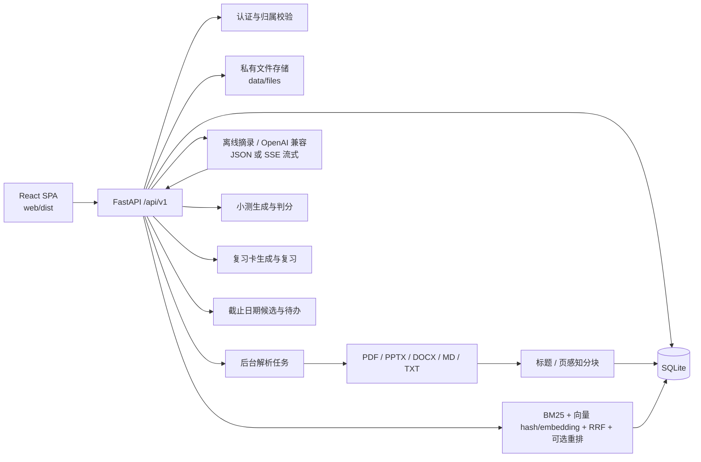
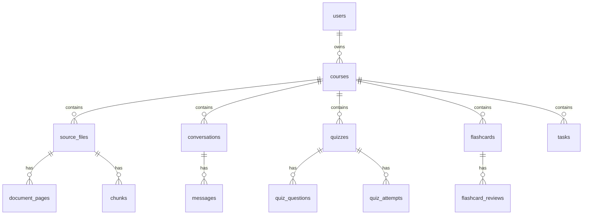

# CourseMate · 开发文档

> 本文档由 `架构设计.md`、`开发计划.md`、`评测报告.md`、`RAG升级改造清单.md` 四份文档合并而成（2026-10-21）。
> 覆盖范围：MVP v1（Phase 1–6）+ Phase 6.5 检索升级 + 流式问答与工作台 UI。
> 面向开发者；面向用户的使用说明见仓库根目录 `README.md`。

## 1. 项目概述与目标

CourseMate 是一个面向学生的私有学习工作台：上传一门课的 PPT、讲义、作业说明和个人笔记后，可以围绕这些资料提问、获得带页码出处的回答、生成小测和复习卡，并沉淀错题与待办。

把散落在课程群、网盘和笔记软件中的课程资料，收敛成一个**可追溯、可练习、可复习**的个人知识库：

- 用自然语言查询已上传的课程材料；
- 每个关键结论都能定位到文件名、页码/幻灯片、章节和原文片段；
- 资料不足时明确拒答，不补全常识；
- 从指定资料生成小测和复习卡，并记录错题与掌握度；
- 从作业说明中提取候选截止日期，经用户确认后形成待办。

一句话验收：**学生能在 3 分钟内完成"上传资料 → 提问 → 打开引用原文"，并愿意在下一门课继续使用。**

设计上优先保证三件事：

1. **可追溯**：回答中的每个要点都能定位到文件、页码/幻灯片或章节；
2. **不臆测**：没有足够资料依据时明确拒答；
3. **不串库**：所有业务查询都带 `user_id + course_id` 约束。

它不是通用聊天机器人，也不替学生完成作业；回答必须优先基于用户已上传的课程材料，并明确展示依据。



## 2. 范围

### 2.1 MVP 必做

1. 账户与课程：注册/登录；创建课程；课程间数据完全隔离。
2. 资料上传与解析：PDF、PPTX、DOCX、Markdown、TXT；显示解析状态与失败原因。
3. 资料库问答：限定单门课程；返回答案、置信状态、引用和原文定位。
4. 引用查看：文件名、页码/幻灯片、章节、原文片段；可打开原文件。
5. 小测：按选定资料生成选择题/简答题；提交后记录对错与解析出处。
6. 复习卡：按选定资料/章节生成问答卡；支持"掌握/不熟"标记。
7. 资料待办：从作业通知提取候选截止日期，用户确认后才保存。

### 2.2 明确不做

| 不做 | 原因 |
|---|---|
| 自动代写作业、论文或代码 | 学习辅助边界与诚信要求 |
| 多人共享资料库与协作 | 先验证个人场景 |
| 把模型回答当作事实 | 以引用和"无依据则拒答"为约束 |
| 第三方日历/微信自动写入 | 避免授权和误操作 |
| 全量 OCR 与手写识别 | 首版只支持可提取文本，扫描件明确报错 |

## 3. 系统架构

### 3.1 总览

CourseMate 是一个同源部署的单页应用：

- 前端：React 19 + Vite 7，构建产物由 FastAPI 静态托管；
- 后端：FastAPI + SQLAlchemy 2 + SQLite；
- 文件：上传后写入 `data/files/{course_id}/`，数据库只保存 `storage_key`；
- 检索：中文 bigram + BM25 + 向量（哈希 TF-IDF 或真实 embedding）+ RRF + 可选重排；
- 生成：默认离线原文摘录；配置 OpenAI 兼容 Provider 时走模型（支持 SSE 流式输出），失败自动降级；
- 评测：`backend/eval/` 下的数据集与脚本，结果见第 11 章。

### 3.2 组件图



### 3.3 技术选型

| 层 | 选择 | 说明 |
|---|---|---|
| 运行时 | Python 3.12+ | PyMuPDF `cp310-abi3` wheel 兼容 3.14 |
| 后端 | FastAPI + Uvicorn | 类型校验、自动 OpenAPI |
| 数据 | SQLAlchemy 2 + SQLite（WAL、外键） | `DATABASE_URL` 可切 PostgreSQL；迁移后再引入 Alembic |
| 鉴权 | httpOnly Cookie + JWT（HS256） | SameSite=Lax；密码 PBKDF2-SHA256 + 随机盐 |
| 前端 | React 19 + react-router-dom 7 + Vite 7 | 原生 CSS；工作台式左侧导航外壳 |
| 检索 | BM25 + 向量 + RRF | 哈希向量零依赖、确定性、离线可用；可切换真实 embedding |
| 生成 | offline / OpenAI 兼容 | 无 Key 也能完整验收；`mode` 字段对外标注 |
| 任务 | FastAPI BackgroundTasks | 启动时对账未完成任务；后续可换 Celery |

### 3.4 目录与职责

| 路径 | 职责 |
|---|---|
| `backend/app/main.py` | 应用工厂、路由挂载、SPA 静态托管 |
| `backend/app/config.py` | `.env` / 环境变量、数据目录、Provider 配置 |
| `backend/app/db.py` | 引擎、会话、SQLite PRAGMA、历史 schema 迁移 |
| `backend/app/models.py` | 14 张表的 ORM 模型与级联关系（含 `chunk_vectors`） |
| `backend/app/schemas.py` | 请求/响应模型与字段校验 |
| `backend/app/deps.py` | 当前用户、课程/文件/对话/卡片/待办归属校验 |
| `backend/app/security.py` | PBKDF2 密码哈希、JWT 会话 Cookie |
| `backend/app/storage.py` | 上传校验、私有存储、下载与删除 |
| `backend/app/routers/` | `auth`、`courses`、`files`、`query`、`quizzes`、`flashcards`、`tasks`、`health` |
| `backend/app/services/` | 解析、分块、分析、检索、向量化、重排、回答、复习卡生成、截止日期提取、摄入与对账 |
| `backend/eval/` | 评测集（40 题 + 12 条语义集）、评测脚本、人工抽样与结果 JSON |
| `backend/scripts/seed_demo.py` | 7 份资料 / 5 种格式的演示课程 |
| `web/src/` | 页面、面板、API 客户端与样式 |
| `docs/` | 本文档 |

## 4. 数据模型



| 表 | 说明 |
|---|---|
| `users` | 用户名唯一，PBKDF2-XJH773 密码哈希 |
| `courses` | 课程、学期、颜色、`index_version` |
| `source_files` | 原名、MIME、大小、`storage_key`、解析状态、错误/警告、页数与块数 |
| `document_pages` | 可定位单元：PDF 页、PPTX 幻灯片、DOCX/MD 章节、TXT 全文 |
| `chunks` | 检索单元，带 `course_id`、`file_id`、页码范围、标题与文本 |
| `chunk_vectors` | 真实 embedding 缓存，主键 `(chunk_id, model)`，float32 字节 |
| `conversations` / `messages` | 课程内问答历史；消息保存引用快照、置信度、拒答标记、`mode`、`model` 与 `degraded` |
| `quizzes` / `quiz_questions` / `quiz_attempts` | 题目、来源 chunk、作答结果与人工改判 |
| `flashcards` / `flashcard_reviews` | 卡片、来源 chunk IDs、掌握度与复习记录 |
| `tasks` | 用户确认后的待办、截止时间、来源文件/片段、完成状态 |

关键约束：

- 所有业务表通过 `course_id` 归属课程；查询入口统一经过 `owned_course` / `owned_file` / `owned_flashcard` / `owned_task` 等依赖；
- 删除课程通过 ORM 级联删除文件、页、chunk、会话、小测、卡片、待办与复习记录，同时删除磁盘文件；
- `citations`、`source_chunk_ids`、`options`、`results` 等结构化字段以 JSON 文本保存，读取时做容错解析。

## 5. 关键流程

### 5.1 认证

1. 注册：校验用户名格式与密码长度（≥8 位），生成随机盐，PBKDF2-XJH773（31 万次）哈希；
2. 登录：校验密码后签发 HS256 JWT，写入 `coursemate_session` httpOnly Cookie（7 天，SameSite=Lax）；
3. 每个受保护请求从 Cookie 解码 `sub`，查询用户；失败返回 401。
4. 注意：当前**没有密码重置接口**，README 的 FAQ 已如实说明。

### 5.2 上传与解析

```text
上传 → 扩展名/MIME/魔数/大小（≤50MB）/空文件校验
     → 写入 data/files/{course_id}/{file_id}{ext}
     → source_files.status = queued
     → BackgroundTasks / 启动对账线程
     → parsing.py 提取页/幻灯片/章节文本
     → chunking.py 分块并写入 chunks
     → 配置了真实 embedding 时自动向量化（容错，失败不影响 ready）
     → status = ready / failed，课程 index_version += 1
```

- PDF 保留页码；PPTX 保留幻灯片号；DOCX 按 Heading 样式分节；Markdown 保留标题路径；TXT 单页全量；
- 分块：标题 + 页感知，目标 400–700 字、重叠约 80 字、单块 ≤1200 字，跨页不合并；
- PDF 的排版折行在抽句前会先拼回段落，避免公式或长句被换行截断；
- 扫描版 PDF 明确失败并提示"不支持 OCR"，不会伪造解析成功；
- 启动时 `reconcile_pending` 会把 `queued/processing` 重新入队，避免重启后卡死。

### 5.3 问答（含流式）

```text
question
  → 页码意图？直接取对应 page/slide 的 chunks
  → 整份总结意图且模型可用？按顺序取样全部/前 40 个 chunks
  → 否则 tokenize + 课程级混合检索 Top-50（user_id + course_id）
       检索为空且模型可用 → 查询改写成英文关键词 → 再检索
  → provider=openai 且用户未关闭？
       是 → 模型 JSON 回答 + 服务端引用校验；流式接口边生成边推送 answer 明文
       失败/不合规 → 降级
  → offline 抽句：覆盖率门槛 + 最佳句子相对阈值
  → 组装 citations
  → 持久化 conversation/messages
```

查询意图（`services/query_intent.py`）：

- 页码：`第13页`、`第 4 张幻灯片`、`slide 22`、`page 7`、`13页` 都会识别为页范围，直接走 `page_hits`；
- 总结：`这份ppt主要讲了什么内容`、`总结一下` 等走 `summary_hits`，最多取 40 块、14000 字符；
- 改写：普通检索为空、模型可用且用户未关闭模型时，调用模型把中文问题改写成英文关键词，再检索一次。

离线分支的两个门槛：

- `MIN_COVERAGE = 0.2`：句子覆盖问题词元的比例过低时直接跳过；
- 只保留与最佳句子分数接近（`best_score * 0.8`）的摘录，减少"同层但无关"的噪声。

回答模型选择：

- `GET /api/v1/answer/config` 返回 `provider`、`model`、`model_available`、`default_use_llm`；
- `POST /courses/{id}/query` 可带 `use_llm`：`false` 强制离线，`true` 要求模型（配置缺失返回 409），省略则沿用服务端默认；
- 在线调用失败会降级为离线回答，并在响应与消息中标记 `degraded=true`；
- 消息持久化 `model` 与 `degraded`，前端每条回答显示实际模型或「原文摘录」。

在线分支要求模型返回 `{answer, citation_indices, confidence, abstained}`；服务端会校验：

- 引用编号在候选范围内；
- `answer` 中出现的 `[n]` 与 `citation_indices` 一致；
- 文件、页码/章节和原文片段能映射到本课程 chunk。

任何异常都会记录 warning 并降级到离线回答。**以上校验逻辑流式与非流式完全共用**（`_finalise_online_payload`），`MIN_COVERAGE` 与引用校验一行未改。

#### 流式问答（SSE）

`POST /api/v1/courses/{id}/query/stream` 返回 `text/event-stream`，事件序列：

```text
meta      {conversation_id}                     会话建立后立即推送
delta     {"text": "..."} × N                   模型 answer 字段的明文增量
replace   {"text": "..."}                       模型失败/不合规时整体替换为降级回答
citations {"citations": [...]}                  校验后的引用快照
done      {answer, confidence, abstained, mode, model, degraded, elapsed_ms}
error     {"message": "..."}                    未预期异常（已回滚事务）
```

实现要点：

- `answering._chat_completion_stream`：同一 OpenAI 兼容端点追加 `stream=True`，逐行解析 SSE；连接中断统一收敛为 `RuntimeError`，走既有降级路径；
- `answering._AnswerFieldDecoder`：从流式 JSON 中增量解出 `answer` 明文（状态机 seek→colon→open_quote→string→done；处理 ```json 围栏、`\"`/`\n` 等转义、`\uXXXX` 与代理对）。解码只负责"看到文字"，正确性仍由完整 JSON 解析 + 引用校验保证；
- 会话创建与 404/409 校验在流开始前完成，保证错误能作为常规 HTTP 响应返回；
- 用户消息与助手消息在生成结束后同一事务提交，异常时回滚，不留半截会话；
- 离线回答作为单个 delta 一次性给出（前端仅对模型回答使用流式）。

### 5.4 小测

- 从课程/资料范围的 ready chunks 中提取术语和句子；
- 选择题：术语挖空 + 同课程干扰项；简答题：补全术语；
- 提交时选择题精确匹配，简答题按关键词覆盖率 ≥60% 判分；
- 每题保存 `chunk_id`、参考答案、解析与出处；简答题允许人工改判。

### 5.5 复习卡

- 生成：优先定义句式（"X 是/指/用于/负责…"），其次领域后缀和英文缩写；同一术语只生成一次；
- 手动创建：正面/背面 + 可选来源 chunk；
- 复习：`mastered` / `unfamiliar` 写入 `flashcard_reviews`，同时更新卡片掌握度；
- 列表返回来源文件、定位、原文片段、复习次数与最近复习时间。

### 5.6 待办

```text
扫描资料页/章节
  → 只处理包含"截止 / 提交 / 上交 / deadline / due"等表述的句子
  → 解析绝对日期、月日、相对日期（明天/下周五/3 天后）
  → 解析时间（23:59、下午 3 点、3 点）
  → 生成候选（不落库）
  → 用户确认/修改时间
  → POST /tasks 创建 confirmed=True 的待办
```

- 相对日期、缺年份、缺具体时间、日期已过都会标记 `needs_confirmation` 并给出原因；
- 待办保存 UTC 时间，前端按浏览器本地时区展示；
- 候选本身不写数据库，避免模型/规则误判直接变成用户承诺。

## 6. 检索与 RAG

### 6.1 检索实现

```text
chunks
  ├─ 分词：中文 bigram，英文/数字按词，过滤停用词
  ├─ BM25：k1=1.5, b=0.75
  └─ 向量通道（二选一，随 provider 切换）
       ├─ hash：blake2b(term) → 768 维稀疏桶，L2 归一化（默认，零依赖）
       └─ openai：真实 embedding → chunk_vectors 表按模型存储，float32 字节，L2 归一化
查询
  ├─ BM25 Top-50
  ├─ 向量 Top-50
  ├─ RRF(k=60) 融合 → Top-50
  └─ rerank 可用？Cross-encoder 精排回 Top-6；否则直接截断
```

- 索引按课程缓存在进程内，键为 `(courses.index_version, 向量模型名)`；数据变更与切换 embedding 模型都会使缓存失效；
- 哈希向量不是神经 embedding，优点是零依赖、确定性、离线可用；缺点是同义改写召回有限；
- 真实 embedding 走 OpenAI 兼容 `/embeddings`，输出统一 L2 归一化后与查询向量点积；
- `chunk_vectors` 主键为 `(chunk_id, model)`，换模型不销毁旧向量，可并行新旧两套对比；
- `scripts/reindex_vectors.py` 负责回填（`--force` 覆盖、`--dry-run` 预估），写完会显式失效缓存；
- 文档解析成功后由 `ingest._embed_new_chunks` 自动补齐该文件的向量，失败只记日志，不影响 `ready` 状态；
- **向量不全时整体退回哈希向量**，绝不混合两种通道排序——混合排序没有意义；
- `GET /api/v1/health` 暴露 `embedding.coverage`，可判断检索是否真的用上了语义向量。

### 6.2 RAG 升级记录（Phase 6.5，2026-10-20 完成）

目标：把检索端从**词面近似**升级为**真语义向量 + 重排**，同时**不破坏**"无 API Key 也能完整演示"的离线能力。

五条约束（违反任何一条都算方案失败）：

| 约束 | 具体要求 |
|---|---|
| C1 不破坏离线 | `COURSEMATE_EMBEDDING_PROVIDER=hash`（默认）时行为与升级前一致，全部测试照常通过 |
| C2 不破坏引用 | `answering.py` 的引用校验、`MIN_COVERAGE` 拒答门槛、降级逻辑一行都不改 |
| C3 不改前端契约 | `QueryResponse` 字段不变；新能力只加可选字段 |
| C4 失败不阻断 | 向量化/重排任何异常都降级到 hash / 不重排，绝不把文件标成 `failed` |
| C5 可回滚 | 改一个环境变量即可退回原状态，不需要回滚数据库 |

实施内容：

- `services/embedding.py`（新增）：`Embedder` 协议、`OpenAIEmbedder`（乱序重排、分批、维度校验）、`get_embedder` / `embed_texts` 容错版；
- `services/vectors.py`（新增）：float32 编解码、`vector_coverage`、`ensure_vectors`、`load_vectors`、`delete_vectors_for_model`；
- `services/rerank.py`（新增）：Cohere / Jina 兼容 `/rerank`，失败降级为 RRF 顺序，默认关闭；
- `retrieval.py`：`CourseIndex` 支持外部向量；缓存键改为 `(index_version, 模型名)`；`hybrid_search` 透传 settings 与 query 向量；
- `ingest.py`：解析成功后自动向量化，整体 try/except 兜底；
- `models.py`：+`ChunkVector`（主键 `chunk_id + model`）；
- `health.py`：`/health` 增加 `embedding` 块（provider / model / coverage / dense_ready）；
- `query.py`：检索 Top-K 6 → 50，重排回 6；
- `scripts/reindex_vectors.py`（新增）：回填脚本，`--course-id` / `--force` / `--dry-run`；
- `eval/run_eval.py`：`--dataset` / `--save` / `--baseline` / `--no-report`；新增 `eval/semantic.json` 12 条语义评测集。

三个必须先知道的结论：

1. **语义集基线是 0.000，不是 0.7。** 最初设计的中文同义改写题在 18 个 chunk 的演示语料上 Top-5 几乎必然覆盖目标，没有判别力；最终把关键权重放到 6 条英文提问上——哈希检索对跨语言完全是 0。语料太小时不要指望用同义改写题衡量检索质量。
2. **语义检索只解决「找得到」，不解决「答得出」。** 英文提问检索 100% 命中中文块，但 `_offline_answer` 仍拒答（原文没有对应词元）。要真正回答必须同时配 `COURSEMATE_LLM_PROVIDER=openai`。该行为由 `tests/test_rag_pipeline.py::test_cross_lingual_recall_works_but_offline_still_refuses` 固化。
3. **测试里的两个 API 陷阱**：`files.py` 上传走 `BackgroundTasks`，测试里手动调 `run_ingest` 会和后台任务赛跑，需要轮询；`Settings` 是 frozen dataclass，测试改配置必须用 `dataclasses.replace`。

回滚：`.env` 改回 `COURSEMATE_EMBEDDING_PROVIDER=hash`、`COURSEMATE_RERANK_ENABLED=0` 即可；`chunk_vectors` 表不影响任何现有查询路径。

## 7. API

| 分组 | 接口 |
|---|---|
| 账户 | `POST /api/v1/auth/register`、`POST /api/v1/auth/login`、`POST /api/v1/auth/logout`、`GET /api/v1/auth/me` |
| 课程 | `GET/POST /api/v1/courses`、`GET/PATCH/DELETE /api/v1/courses/{id}` |
| 资料 | `POST /api/v1/courses/{id}/files`、`GET /api/v1/courses/{id}/files`、`GET /api/v1/files/{id}`、`GET /api/v1/files/{id}/download`、`GET /api/v1/files/{id}/pages`、`GET /api/v1/files/{id}/pages/{ord}`、`POST /api/v1/files/{id}/reprocess`、`DELETE /api/v1/files/{id}` |
| 问答 | `GET /api/v1/answer/config`、`POST /api/v1/courses/{id}/query`、`POST /api/v1/courses/{id}/query/stream`（SSE）、`GET /api/v1/courses/{id}/conversations`、`GET /api/v1/conversations/{id}/messages` |
| 小测 | `POST /api/v1/courses/{id}/quizzes`、`GET /api/v1/quizzes/{id}`、`POST /api/v1/quizzes/{id}/attempts`、`GET /api/v1/courses/{id}/attempts`、`PATCH /api/v1/attempts/{id}/regrade` |
| 复习卡 | `GET/POST /api/v1/courses/{id}/flashcards`、`POST /api/v1/courses/{id}/flashcards/generate`、`POST /api/v1/flashcards/{id}/reviews`、`DELETE /api/v1/flashcards/{id}` |
| 待办 | `GET/POST /api/v1/courses/{id}/tasks`、`POST /api/v1/courses/{id}/tasks/candidates`、`PATCH/DELETE /api/v1/tasks/{id}` |
| 健康 | `GET /api/v1/health` |

问答响应在项目文档示例基础上增加 `confidence`、`mode`、`conversation_id`、`elapsed_ms`，引用项增加 `chunk_id`、`file_id`、`heading`、`locator`。`/query/stream` 的事件协议见 5.3。

## 8. 前端

| 页面/组件 | 说明 |
|---|---|
| `LoginPage` | 登录/注册同页切换 |
| `CoursesPage` | 课程列表、新建、删除 |
| `AppShell` | 工作台外壳：左侧固定导航（品牌、当前课程卡、五个功能入口带图标与徽章、用户区），≤1080px 折叠为图标栏 |
| `CoursePage` | 课程工作台：页头（统计 chips）+ 五个面板 |
| `FileDrop` / `StatusBadge` / `Modal` | 上传、状态、预览 |
| `ChatPanel` | 对话流、引用、拒答、历史；模型回答走 SSE 流式逐段渲染（含生成中光标），失败自动回退非流式接口 |
| `QuizPanel` | 生成、作答、判分、错题、改判 |
| `FlashcardsPanel` | 生成/手建/翻面/掌握度/删除 |
| `TasksPanel` | 候选确认、手动添加、逾期、完成、编辑、删除 |

所有请求经 `web/src/api.js` 走同源 `/api/v1`，Cookie 自动携带；前端只做展示，不参与权限判断。`api.queryStream` 用 fetch + ReadableStream 手写 SSE 解析（`\n\n` 分帧、缓冲拼接），EventSource 不支持 POST 故未采用。

## 9. 安全与隔离

- 密码：PBKDF2-XJH773 + 随机 16 字节盐，31 万次迭代；
- 会话：HS256 JWT + httpOnly Cookie；`COURSEMATE_COOKIE_SECURE=1` 时加 Secure；
- 文件：生成式文件名，`storage_key` 不暴露原始路径；下载/删除均做归属校验；
- 越权：课程、文件、对话、小测、复习卡、待办均通过 join `courses.user_id` 校验，统一返回 404；
- 级联：删除课程清理数据库记录与磁盘文件；删除文件清理页/chunk；
- 提示词：在线模式强制只依据课程资料回答，服务端二次校验引用，不信任模型返回的越界编号。

## 10. 配置与部署

```powershell
powershell -ExecutionPolicy Bypass -File scripts\setup.ps1       # 后端依赖（一次性）
powershell -ExecutionPolicy Bypass -File scripts\build-web.ps1   # 前端构建（一次性）
powershell -ExecutionPolicy Bypass -File scripts\run.ps1         # 启动 http://127.0.0.1:8000
```

- `load_settings()` 会自动读取仓库根目录 `.env`；已存在的进程环境变量优先；
- `.env` 中的相对路径按仓库根目录解析，避免从 `backend/` 启动时路径漂移；
- 常用变量见 `.env.example`（完整清单见附录 B）；
- `COURSEMATE_LLM_PROVIDER=openai` 且 Base URL / Key / Model 齐全时，`/answer/config` 返回可用模型；用户可在问答页切换离线回答；
- 演示数据：`backend/scripts/seed_demo.py`（账号 `demo / coursemate123`，课程"计算机网络（演示）"）；
- 评测：`backend/eval/run_eval.py`；真实 embedding 回填：`backend/scripts/reindex_vectors.py`。

```bash
# 真实语义向量（可选，默认 hash 零依赖）
COURSEMATE_EMBEDDING_PROVIDER=openai
COURSEMATE_EMBEDDING_BASE_URL=https://api.siliconflow.cn/v1
COURSEMATE_EMBEDDING_API_KEY=
COURSEMATE_EMBEDDING_MODEL=BAAI/bge-m3
COURSEMATE_EMBEDDING_DIM=1024

# 重排（可选，默认关闭）
COURSEMATE_RERANK_ENABLED=0
```

## 11. 测试与评测

### 11.1 测试分层

- **单元**：分词、分块、BM25/向量/RRF、拒答阈值、引用校验、日期提取、模型选择/降级、页码/总结意图、查询改写、密码哈希、JWT、流式解码器；
- **集成**：注册登录、课程 CRUD、5 格式上传→解析→ready、问答（JSON 与 SSE）、小测、卡片、待办、下载鉴权、级联删除；
- **越权**：用户 B 访问用户 A 的课程/文件/对话/题目/卡片一律 404；跨课程检索不串数据；
- **规模**：RAG 升级后 126 个用例；流式问答新增 19 个后**全量 145 通过**（2026-10-21）。

```powershell
powershell -ExecutionPolicy Bypass -File scripts\test.ps1
```

> 本机沙箱对 `os.mkdir(0o700)` 有兼容性问题，测试脚本会临时加载 `scripts/pysite` 补丁；普通开发机直接 `pytest` 即可。

### 11.2 评测设计

- 数据集：`backend/eval/dataset.json` 40 条（32 条可答 + 8 条无答案，20%），覆盖 5 种格式；
- 语义集：`backend/eval/semantic.json` 12 条（10 可答 + 2 无答案），问法与原文词面不重合（6 条英文提问命中中文资料 + 4 条中文同义改写）；
- 指标：Recall@5、引用定位合法率、无答案拒答率、p95、解析成功率、关键词支持率、20 条人工抽样支持率；
- 判定：Top-5 命中预期文件与页码/幻灯片/章节；引用需能映射回本课程 chunk；
- 人工抽样记录在 `backend/eval/manual_support.json`。

### 11.3 评测结果（2026-10-20，演示课程）

| 指标 | 结果 | 目标 | 状态 |
|---|---:|---:|---|
| 检索 Recall@5 | 1.000 | ≥ 0.80 | ✅ |
| 引用定位合法率 | 100.0% | 100% | ✅ |
| 无答案拒答率 | 100.0%（8/8） | ≥ 80% | ✅ |
| 抽样支持率（人工） | 100.0%（20 条） | ≥ 90% | ✅ |
| 问答 p95 | 294 ms（离线）/ 1696 ms（真实 LLM 端到端） | ≤ 8000 ms | ✅ |
| 解析成功率 | 100.0%（7/7） | ≥ 95% | ✅ |
| 关键词支持率（自动） | 100.0% | 参考 | — |

语义集对比（升级的唯一硬证据）：

| 数据集 | 题数 | Recall@5 | 拒答率 | 用途 |
|---|---:|---:|---:|---|
| `dataset.json` | 40 | 1.000 | 8/8 | 回归：升级后不得下降 |
| `semantic.json`（hash 基线） | 12 | **0.000** | 2/2 | 升级前基线 |
| `semantic.json`（真实 embedding） | 12 | **1.000** | 2/2 | 升级后对比 |

追加验证：语义集 + 真实 LLM（DeepSeek）端到端，10 条跨语言题全部带有效引用用中文回答，2 条无答案仍正确拒答。存档：`backend/eval/semantic_openai.json`（离线）、`semantic_openai_llm.json`（LLM）。

### 11.4 逐题结果（dataset.json，40 条）

| ID | 问题 | 可答 | Recall@5 | 是否拒答 | 引用合法 |
|---|---|:---:|:---:|:---:|:---:|
| q01 | 协议的三要素是什么？ | 是 | ✅ | 否 | ✅ |
| q02 | OSI 参考模型分为哪七层？ | 是 | ✅ | 否 | ✅ |
| q03 | TCP/IP 模型通常分为哪四层？ | 是 | ✅ | 否 | ✅ |
| q04 | 物理层的主要功能是什么？ | 是 | ✅ | 否 | ✅ |
| q05 | 奈奎斯特准则的内容是什么？ | 是 | ✅ | 否 | ✅ |
| q06 | 香农定理的公式是什么？ | 是 | ✅ | 否 | ✅ |
| q07 | 光纤相比双绞线有什么优点？ | 是 | ✅ | 否 | ✅ |
| q08 | 数据链路层的主要功能有哪些？ | 是 | ✅ | 否 | ✅ |
| q09 | CRC 循环冗余校验的作用是什么？ | 是 | ✅ | 否 | ✅ |
| q10 | CSMA/CD 如何工作？ | 是 | ✅ | 否 | ✅ |
| q11 | 以太网帧的最小和最大长度是多少？ | 是 | ✅ | 否 | ✅ |
| q12 | 交换机和路由器分别能隔离什么？ | 是 | ✅ | 否 | ✅ |
| q13 | 网络层提供什么样的服务？ | 是 | ✅ | 否 | ✅ |
| q14 | IPv4 地址长度是多少位？ | 是 | ✅ | 否 | ✅ |
| q15 | 子网掩码 /24 表示什么？ | 是 | ✅ | 否 | ✅ |
| q16 | 路由器如何选择下一跳？ | 是 | ✅ | 否 | ✅ |
| q17 | NAT 的作用是什么？ | 是 | ✅ | 否 | ✅ |
| q18 | TCP 三次握手的过程是什么？ | 是 | ✅ | 否 | ✅ |
| q19 | TCP 四次挥手的过程是什么？ | 是 | ✅ | 否 | ✅ |
| q20 | TCP 滑动窗口如何实现流量控制？ | 是 | ✅ | 否 | ✅ |
| q21 | TCP 拥塞控制包括哪些阶段？ | 是 | ✅ | 否 | ✅ |
| q22 | UDP 首部有哪些字段？ | 是 | ✅ | 否 | ✅ |
| q23 | HTTP 和 HTTPS 的默认端口分别是多少？ | 是 | ✅ | 否 | ✅ |
| q24 | HTTP 状态码 404 表示什么？ | 是 | ✅ | 否 | ✅ |
| q25 | DNS 的作用和默认端口是什么？ | 是 | ✅ | 否 | ✅ |
| q26 | DHCP 能自动分配哪些信息？ | 是 | ✅ | 否 | ✅ |
| q27 | CDN 的作用是什么？ | 是 | ✅ | 否 | ✅ |
| q28 | 实验报告应包含哪五个部分？ | 是 | ✅ | 否 | ✅ |
| q29 | 实验报告的截止时间是什么？ | 是 | ✅ | 否 | ✅ |
| q30 | 迟交实验报告如何扣分？ | 是 | ✅ | 否 | ✅ |
| q31 | 课程总成绩由哪些部分组成？ | 是 | ✅ | 否 | ✅ |
| q32 | 复习时应重点掌握哪些内容？ | 是 | ✅ | 否 | ✅ |
| q33 | 老师上课会不会点名？ | 否 | — | 是 | — |
| q34 | 量子计算机的退相干时间是多少？ | 否 | — | 是 | — |
| q35 | 波音 747 的巡航速度是多少？ | 否 | — | 是 | — |
| q36 | Python 的装饰器怎么写？ | 否 | — | 是 | — |
| q37 | 学校食堂几点开门？ | 否 | — | 是 | — |
| q38 | 莎士比亚的《哈姆雷特》写于哪一年？ | 否 | — | 是 | — |
| q39 | 光合作用的暗反应发生在哪里？ | 否 | — | 是 | — |
| q40 | 珠穆朗玛峰的高度是多少米？ | 否 | — | 是 | — |

失败样例：无。

### 11.5 抽样支持率（人工，20 条）

抽样 20 条：支持 20 条，部分支持 0 条，不支持 0 条；支持率 **100.0%**。

| ID | 问题 | 回答摘录 | 判断 |
|---|---|---|---|
| q01 | 协议的三要素是什么？ | 协议是通信双方必须遵守的规则，三要素是语法、语义和时序。[1] | 支持 |
| q02 | OSI 参考模型分为哪七层？ | OSI 参考模型分为七层：物理层、数据链路层、网络层、传输层、会话层、表示层和应用层。[1] | 支持 |
| q04 | 物理层的主要功能是什么？ | 物理层负责在传输介质上传输原始比特流，主要解决机械、电气、功能和过程特性。[1] | 支持 |
| q05 | 奈奎斯特准则的内容是什么？ | 无噪声理想低通信道的最高码元传输速率为 2W 波特，W 为信道带宽。[1] | 支持 |
| q07 | 光纤相比双绞线有什么优点？ | 带宽高、抗电磁干扰强，适合长距离骨干网。[1] | 支持 |
| q08 | 数据链路层的主要功能有哪些？ | 相邻结点之间的可靠传输，主要功能包括成帧、差错控制和流量控制。[1] | 支持 |
| q10 | CSMA/CD 如何工作？ | 发送前先监听信道，冲突时停止发送并随机退避。[1] | 支持 |
| q12 | 交换机和路由器分别能隔离什么？ | 交换机隔离冲突域，路由器隔离广播域。[1] | 支持 |
| q14 | IPv4 地址长度是多少位？ | 32 位，通常用点分十进制表示。[1] | 支持 |
| q16 | 路由器如何选择下一跳？ | 根据目的 IP 地址查找路由表，最长前缀匹配选择下一跳。[1] | 支持 |
| q17 | NAT 的作用是什么？ | 把私有地址转换为公网地址，缓解 IPv4 地址短缺。[1] | 支持 |
| q18 | TCP 三次握手的过程是什么？ | 客户端发送 SYN，服务器回复 SYN+ACK，客户端再发送 ACK。[1] | 支持 |
| q19 | TCP 四次挥手的过程是什么？ | 主动关闭方发送 FIN，对方回复 ACK，随后发送 FIN，主动方回复 ACK。[1] | 支持 |
| q21 | TCP 拥塞控制包括哪些阶段？ | 慢开始、拥塞避免、快重传和快恢复四个阶段。[1] | 支持 |
| q22 | UDP 首部有哪些字段？ | 8 字节，包含源端口、目的端口、长度和校验和。[1] | 支持 |
| q23 | HTTP 和 HTTPS 的默认端口分别是多少？ | HTTP 80，HTTPS 443，HTTPS 使用 TLS 加密。[1] | 支持 |
| q25 | DNS 的作用和默认端口是什么？ | 把域名解析为 IP 地址，默认端口 53。[1] | 支持 |
| q29 | 实验报告的截止时间是什么？ | 2026 年 11 月 8 日 23:59，提交到课程平台。[1] | 支持 |
| q30 | 迟交实验报告如何扣分？ | 迟交一天扣 10 分，超过三天按零分计。[1] | 支持 |
| q31 | 课程总成绩由哪些部分组成？ | 实验报告 30%、课堂参与和平时作业 20%、期末考试 50%。[1] | 支持 |

### 11.6 评测局限

- 评测基于合成演示课程，不等于真实课程资料分布；
- 离线回答是原文摘录，不覆盖需要跨段总结的问题；
- 抽样支持率是开发者人工判断，样本量 20，未做多人标注一致性检验。

## 12. 开发历程与里程碑

| 阶段 | 内容 | 状态 |
|---|---|---|
| 第 1 周 | 骨架、账户、课程、上传 | ✅ |
| 第 2 周 | 解析、分块、索引 | ✅ |
| 第 3 周 | 带引用问答与拒答 | ✅ |
| 第 4 周 | 小测、作答与错题 | ✅ |
| 第 5 周 | 复习卡、待办、前端打磨 | ✅ |
| 第 6 周 | 评测、演示数据、文档 | ✅ |
| 后续优化 | 回答模型选择、查询改写、按页/整份提问 | ✅ |
| Phase 6.5 | RAG 升级：真实 embedding + 重排 + 语义评测集 | ✅（2026-10-20，R5.3 硬门槛通过） |
| 2026-10-21 | SSE 流式问答（+19 测试，全量 145）；前端工作台化（AppShell 左侧导航） | ✅ |

3–5 位同学的任务测试（上传资料、找到作业要求、完成一次小测）安排在发布后执行。

## 13. 验收标准与结果

| 维度 | 指标 | 目标 | 演示课程结果 |
|---|---|---|---|
| 检索 | Recall@5 | ≥ 0.80 | 1.000 |
| 引用 | 页码/文件定位合法率 | 100% | 100.0% |
| 引用 | 抽样支持率 | ≥ 90% | 100.0%（20 条人工抽样） |
| 拒答 | 无答案问题正确拒答率 | ≥ 80% | 100.0%（8/8） |
| 体验 | 已索引课程问答 p95 | ≤ 8 秒 | 294 ms（离线）/ 1696 ms（LLM） |
| 可靠性 | 上传后解析成功率（支持类型） | ≥ 95% | 100.0%（7/7） |

> 结果来自合成演示课程评测，不能外推到真实课程资料。

## 14. 风险、局限与后续

### 14.1 风险与应对

| 风险 | 应对 |
|---|---|
| 无 API Key 时回答为摘录式 | 默认离线 provider；界面标注 `mode`；README 给 OpenAI 兼容配置 |
| 中文检索效果 | bigram 分词 + 双路检索 + RRF；评测集校准拒答阈值 |
| 扫描 PDF 无文本 | 明确 failed + 原因，不伪造成功；OCR 列为后续 |
| PPT 排版复杂 | 以幻灯片为最小定位单位；保留原文件 |
| 生成题目错误 | 每题显示来源；用户可标记"题目有误"（后续） |
| 数据串库 | 强制 user_id/course_id；专项越权测试 |
| 文件与学习记录隐私 | 私有存储、下载鉴权、删除级联 |
| 后台任务中断 | 启动时重新入队 queued/processing |
| 流式中途失败 | `replace` 事件整体替换为降级回答；事务回滚不留半截会话 |

### 14.2 已知局限

| 局限 | 影响 | 后续方向 |
|---|---|---|
| 语义检索只解决「找得到」 | 跨语言提问即使命中，离线摘录仍拒答 | 离线分支加查询翻译或默认走生成 |
| 离线回答只摘原句 | 不总结、不改写、不处理多跳问题 | 在线 Provider；抽取式摘要 |
| 小测/复习卡靠规则生成 | 题目和卡片质量受原文影响 | 模型生成 + 人工编辑 + 质量标注 |
| 无 OCR | 扫描件明确失败；图片型 PPT 只能提取标题/文本框 | 异步 OCR 或视觉模型 |
| SQLite + 进程内任务 | 多实例/高并发能力有限 | PostgreSQL + Celery/Redis |
| 单人账户 | 无共享与协作 | 多用户权限模型 |
| 评测是合成课程 | 指标不代表真实课程分布 | 真实课程评测与同学试用 |

### 14.3 后续迭代

- 真实课程资料上的复测、3–5 位同学试用；
- 扫描件 OCR（异步队列）；
- PostgreSQL + Alembic 迁移、Celery/Redis；
- 多用户共享与权限、导出与备份；
- 复习算法（间隔重复）、错题智能组卷；
- 端到端测试与持续集成。

## 附录 A · 实现陷阱（踩过的坑）

1. `files.py` 上传走 `BackgroundTasks`，测试里手动调 `run_ingest` 会和后台任务赛跑，需要 `_wait_until_ready` 轮询；
2. `Settings` 是 frozen dataclass，测试改配置必须用 `dataclasses.replace`；
3. `urllib.request.urlopen` 的 `timeout` 只接受单值（连接与读取共用），不接受 `(connect, read)` 元组；
4. `reindex_vectors.py` 曾漏 import `delete`，dry-run 被缺失的表挡住，NameError 到真正写入时才暴露——脚本必须完整执行过一次再相信它；
5. `eval/run_eval.py` 曾未给 `hybrid_search` 传 settings，`settings=None` 时检索走纯哈希路径，评测永远测不到真实 embedding；
6. 流式 JSON 增量解码：seek 阶段未命中 `"answer"` 键时不能清空缓冲区，必须保留键长-1 的尾部，否则跨块的键被丢弃；
7. 全局 `.small` 类是按钮尺寸类（`padding: 6px 12px`），与品牌标记类名组合会互相污染，需显式 `padding: 0` 覆盖。

## 附录 B · 环境变量清单

| 变量 | 默认 | 说明 |
|---|---|---|
| `COURSEMATE_DATA_DIR` | `data/` | 数据目录（相对路径按仓库根解析） |
| `COURSEMATE_DATABASE_URL` | `sqlite:///data/coursemate.db` | 数据库连接 |
| `COURSEMATE_SECRET_KEY` | 自动生成并落盘 | JWT 签名密钥 |
| `COURSEMATE_MAX_UPLOAD_MB` | `50` | 单文件上传上限 |
| `COURSEMATE_COOKIE_SECURE` | `0` | `1` 时会话 Cookie 加 Secure |
| `COURSEMATE_LLM_PROVIDER` | `offline` | `openai` 时启用模型回答 |
| `COURSEMATE_LLM_BASE_URL` / `COURSEMATE_LLM_API_KEY` / `COURSEMATE_LLM_MODEL` | 空 | OpenAI 兼容对话服务 |
| `COURSEMATE_EMBEDDING_PROVIDER` | `hash` | `openai` 时启用真实语义向量 |
| `COURSEMATE_EMBEDDING_BASE_URL` / `COURSEMATE_EMBEDDING_API_KEY` / `COURSEMATE_EMBEDDING_MODEL` / `COURSEMATE_EMBEDDING_DIM` | 空 / `1024` | OpenAI 兼容 embedding 服务 |
| `COURSEMATE_EMBEDDING_BATCH` | `32` | 向量化分批大小 |
| `COURSEMATE_RERANK_ENABLED` | `0` | `1` 时启用 Cross-encoder 重排 |
| `COURSEMATE_RERANK_BASE_URL` / `COURSEMATE_RERANK_API_KEY` / `COURSEMATE_RERANK_MODEL` | 空 | Cohere / Jina 兼容 `/rerank` |


