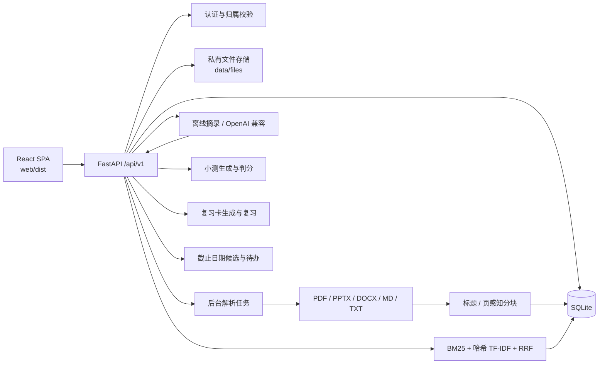
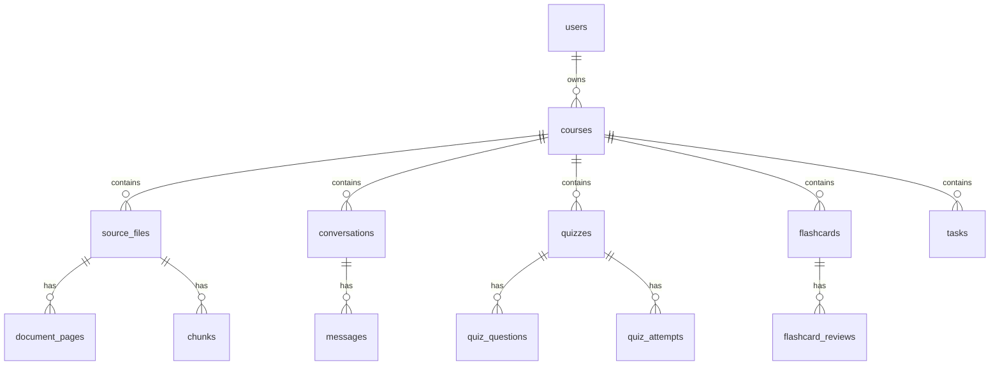

# CourseMate · 架构设计

> 适用版本：MVP v1（Phase 1–6）
> 目标：单学生、本地部署、可追溯的课程资料问答与复习闭环

## 1. 总览

CourseMate 是一个同源部署的单页应用：

- 前端：React 19 + Vite 7，构建产物由 FastAPI 静态托管；
- 后端：FastAPI + SQLAlchemy 2 + SQLite；
- 文件：上传后写入 `data/files/{course_id}/`，数据库只保存 `storage_key`；
- 检索：中文 bigram + BM25 + 哈希 TF-IDF 向量 + RRF，不依赖外部模型；
- 生成：默认离线原文摘录；配置 OpenAI 兼容 Provider 时走模型，失败自动降级；
- 评测：`backend/eval/` 下的 40 条数据集与脚本，报告在 `docs/评测报告.md`。

设计上优先保证三件事：

1. **可追溯**：回答中的每个要点都能定位到文件、页码/幻灯片或章节；
2. **不臆测**：没有足够资料依据时明确拒答；
3. **不串库**：所有业务查询都带 `user_id + course_id` 约束。

## 2. 组件图



## 3. 目录与职责

| 路径 | 职责 |
|---|---|
| `backend/app/main.py` | 应用工厂、路由挂载、SPA 静态托管 |
| `backend/app/config.py` | `.env` / 环境变量、数据目录、Provider 配置 |
| `backend/app/db.py` | 引擎、会话、SQLite PRAGMA、历史 schema 迁移 |
| `backend/app/models.py` | 13 张表的 ORM 模型与级联关系 |
| `backend/app/schemas.py` | 请求/响应模型与字段校验 |
| `backend/app/deps.py` | 当前用户、课程/文件/对话/卡片/待办归属校验 |
| `backend/app/security.py` | PBKDF2 密码哈希、JWT 会话 Cookie |
| `backend/app/storage.py` | 上传校验、私有存储、下载与删除 |
| `backend/app/routers/` | `auth`、`courses`、`files`、`query`、`quizzes`、`flashcards`、`tasks`、`health` |
| `backend/app/services/` | 解析、分块、分析、检索、回答、复习卡生成、截止日期提取、摄入与对账 |
| `backend/eval/` | 40 条评测集、评测脚本、人工抽样与结果 JSON |
| `backend/scripts/seed_demo.py` | 7 份资料 / 5 种格式的演示课程 |
| `web/src/` | 页面、面板、API 客户端与样式 |
| `docs/` | 开发计划、架构设计、评测报告 |

## 4. 数据模型



| 表 | 说明 |
|---|---|
| `users` | 用户名唯一，PBKDF2-SHA256 密码哈希 |
| `courses` | 课程、学期、颜色、`index_version` |
| `source_files` | 原名、MIME、大小、`storage_key`、解析状态、错误/警告、页数与块数 |
| `document_pages` | 可定位单元：PDF 页、PPTX 幻灯片、DOCX/MD 章节、TXT 全文 |
| `chunks` | 检索单元，带 `course_id`、`file_id`、页码范围、标题与文本 |
| `conversations` / `messages` | 课程内问答历史；消息保存引用快照、置信度、拒答标记与 mode |
| `quizzes` / `quiz_questions` / `quiz_attempts` | 题目、来源 chunk、作答结果与人工改判 |
| `flashcards` / `flashcard_reviews` | 卡片、来源 chunk IDs、掌握度与复习记录 |
| `tasks` | 用户确认后的待办、截止时间、来源文件/片段、完成状态 |

关键约束：

- 所有业务表通过 `course_id` 归属课程；查询入口统一经过 `owned_course` / `owned_file` / `owned_flashcard` / `owned_task` 等依赖。
- 删除课程通过 ORM 级联删除文件、页、chunk、会话、小测、卡片、待办与复习记录，同时删除磁盘文件。
- `citations`、`source_chunk_ids`、`options`、`results` 等结构化字段以 JSON 文本保存，读取时做容错解析。

## 5. 关键请求流程

### 5.1 认证

1. 注册：校验用户名格式与密码长度，生成随机盐，PBKDF2-SHA256（31 万次）哈希；
2. 登录：校验密码后签发 HS256 JWT，写入 `coursemate_session` httpOnly Cookie（7 天，SameSite=Lax）；
3. 每个受保护请求从 Cookie 解码 `sub`，查询用户；失败返回 401。

### 5.2 上传与解析

```text
上传 → 扩展名/MIME/魔数/大小/空文件校验
     → 写入 data/files/{course_id}/{file_id}{ext}
     → source_files.status = queued
     → BackgroundTasks / 启动对账线程
     → parsing.py 提取页/幻灯片/章节文本
     → chunking.py 分块并写入 chunks
     → status = ready / failed，课程 index_version += 1
```

- PDF 保留页码；PPTX 保留幻灯片号；DOCX 按 Heading 样式分节；Markdown 保留标题路径；TXT 单页全量。
- PDF 的排版折行在抽句前会先拼回段落，避免公式或长句被换行截断。
- 扫描版 PDF 明确失败并提示“不支持 OCR”，不会伪造解析成功。
- 启动时 `reconcile_pending` 会把 `queued/processing` 重新入队，避免重启后卡死。

### 5.3 问答

```text
question
  → tokenize
  → 课程级混合检索 Top-5/Top-6（user_id + course_id）
  → provider=openai 且配置完整？
       是 → 模型 JSON 回答 + 服务端引用校验
       失败/不合规 → 降级
  → offline 抽句：覆盖率门槛 + 最佳句子相对阈值
  → 组装 citations
  → 持久化 conversation/messages
```

离线分支的两个门槛：

- `MIN_COVERAGE = 0.2`：句子覆盖问题词元的比例过低时直接跳过；
- 只保留与最佳句子分数接近（`best_score * 0.8`）的摘录，减少“同层但无关”的噪声。

在线分支要求模型返回 `{answer, citation_indices, confidence, abstained}`；服务端会校验：

- 引用编号在候选范围内；
- `answer` 中出现的 `[n]` 与 `citation_indices` 一致；
- 文件、页码/章节和原文片段能映射到本课程 chunk。

任何异常都会记录 warning 并降级到离线回答。

### 5.4 小测

- 从课程/资料范围的 ready chunks 中提取术语和句子；
- 选择题：术语挖空 + 同课程干扰项；简答题：补全术语；
- 提交时选择题精确匹配，简答题按关键词覆盖率 ≥60% 判分；
- 每题保存 `chunk_id`、参考答案、解析与出处；简答题允许人工改判。

### 5.5 复习卡

- 生成：优先定义句式（“X 是/指/用于/负责…”），其次领域后缀和英文缩写；同一术语只生成一次；
- 手动创建：正面/背面 + 可选来源 chunk；
- 复习：`mastered` / `unfamiliar` 写入 `flashcard_reviews`，同时更新卡片掌握度；
- 列表返回来源文件、定位、原文片段、复习次数与最近复习时间。

### 5.6 待办

```text
扫描资料页/章节
  → 只处理包含“截止 / 提交 / 上交 / deadline / due”等表述的句子
  → 解析绝对日期、月日、相对日期（明天/下周五/3 天后）
  → 解析时间（23:59、下午 3 点、3 点）
  → 生成候选（不落库）
  → 用户确认/修改时间
  → POST /tasks 创建 confirmed=True 的待办
```

- 相对日期、缺年份、缺具体时间、日期已过都会标记 `needs_confirmation` 并给出原因；
- 待办保存 UTC 时间，前端按浏览器本地时区展示；
- 候选本身不写数据库，避免模型/规则误判直接变成用户承诺。

## 6. 检索实现

```text
chunks
  ├─ 分词：中文 bigram，英文/数字按词，过滤停用词
  ├─ BM25：k1=1.5, b=0.75
  └─ 哈希 TF-IDF：blake2b(term) → 768 维稀疏向量，L2 归一化
查询
  ├─ BM25 Top-50
  ├─ 向量 Top-50
  └─ RRF(k=60) 融合 → Top-N
```

- 索引按课程缓存在进程内，`courses.index_version` 变化后自动重建；
- 上传、重新解析、删除文件或课程都会使缓存失效；
- 哈希向量不是神经 embedding，优点是零依赖、确定性、离线可用；缺点是同义改写召回有限。
- 当前未引入 rerank，Recall@5 在演示集上为 1.000，但不能外推到真实课程。

## 7. 前端结构

| 页面/组件 | 说明 |
|---|---|
| `LoginPage` | 登录/注册同页切换 |
| `CoursesPage` | 课程列表、新建、删除 |
| `CoursePage` | 课程头部 + 五个标签页 |
| `FileDrop` / `StatusBadge` / `Modal` | 上传、状态、预览 |
| `ChatPanel` | 对话流、引用、拒答、历史 |
| `QuizPanel` | 生成、作答、判分、错题、改判 |
| `FlashcardsPanel` | 生成/手建/翻面/掌握度/删除 |
| `TasksPanel` | 候选确认、手动添加、逾期、完成、编辑、删除 |

所有请求经 `web/src/api.js` 走同源 `/api/v1`，Cookie 自动携带；前端只做展示，不参与权限判断。

## 8. 安全与隔离

- 密码：PBKDF2-SHA256 + 随机 16 字节盐，31 万次迭代；
- 会话：HS256 JWT + httpOnly Cookie；`COURSEMATE_COOKIE_SECURE=1` 时加 Secure；
- 文件：生成式文件名，`storage_key` 不暴露原始路径；下载/删除均做归属校验；
- 越权：课程、文件、对话、小测、复习卡、待办均通过 join `courses.user_id` 校验，统一返回 404；
- 级联：删除课程清理数据库记录与磁盘文件；删除文件清理页/chunk；
- 提示词：在线模式强制只依据课程资料回答，服务端二次校验引用，不信任模型返回的越界编号。

## 9. 配置与部署

```powershell
powershell -ExecutionPolicy Bypass -File scripts\setup.ps1
powershell -ExecutionPolicy Bypass -File scripts\build-web.ps1
powershell -ExecutionPolicy Bypass -File scripts\run.ps1
```

- `load_settings()` 会自动读取仓库根目录 `.env`；已存在的进程环境变量优先；
- `.env` 中的相对路径按仓库根目录解析，避免从 `backend/` 启动时路径漂移；
- 常用变量见 `.env.example`：`COURSEMATE_DATA_DIR`、`COURSEMATE_DATABASE_URL`、`COURSEMATE_SECRET_KEY`、`COURSEMATE_MAX_UPLOAD_MB`、`COURSEMATE_LLM_*`、`COURSEMATE_COOKIE_SECURE`；
- 演示数据：`backend/scripts/seed_demo.py`（账号 `demo / coursemate123`，课程“计算机网络（演示）”）；
- 评测：`backend/eval/run_eval.py`。

## 10. 评测设计

- 数据集：40 条，32 条可答 + 8 条无答案（20%），覆盖 5 种格式；
- 指标：Recall@5、引用定位合法率、无答案拒答率、p95、解析成功率、自动关键词支持率、20 条人工抽样支持率；
- 判定：Top-5 命中预期文件与页码/幻灯片/章节；引用需能映射回本课程 chunk；
- 报告：`docs/评测报告.md`，逐题结果和抽样表由脚本生成，人工判断记录在 `backend/eval/manual_support.json`。

## 11. 已知局限

| 局限 | 影响 | 后续方向 |
|---|---|---|
| 哈希 TF-IDF 是词面近似 | 同义改写、跨语言检索弱 | 接入真实 embedding + rerank |
| 离线回答只摘原句 | 不总结、不改写、不处理多跳问题 | 在线 Provider；抽取式摘要 |
| 小测/复习卡靠规则生成 | 题目和卡片质量受原文影响 | 模型生成 + 人工编辑 + 质量标注 |
| 无 OCR | 扫描件明确失败 | 异步 OCR 队列 |
| SQLite + 进程内任务 | 多实例/高并发能力有限 | PostgreSQL + Celery/Redis |
| 单人账户 | 无共享与协作 | 多用户权限模型 |
| 评测是合成课程 | 指标不代表真实课程分布 | 真实课程评测与同学试用 |

## 12. 关键取舍

1. **不引入向量数据库**：MVP 先用 SQLite + 进程内索引，减少部署依赖；接口保留可替换空间。
2. **离线优先**：没有 API Key 也能完整演示；在线模式作为增强，而不是运行前提。
3. **引用先于生成**：无论离线还是在线，回答必须能映射回课程 chunk；无法映射就降级或拒答。
4. **候选不落库**：待办候选只是建议，只有用户确认后才创建任务。
5. **UTC 存储、本地展示**：数据库统一存 UTC，前端用浏览器时区展示截止时间。
